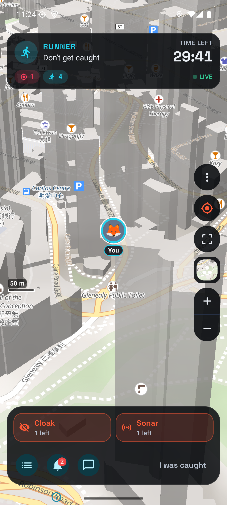
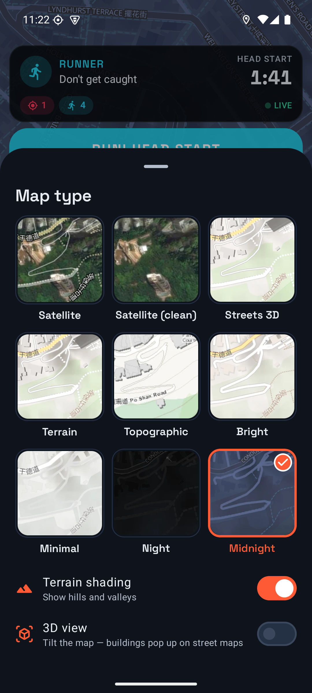
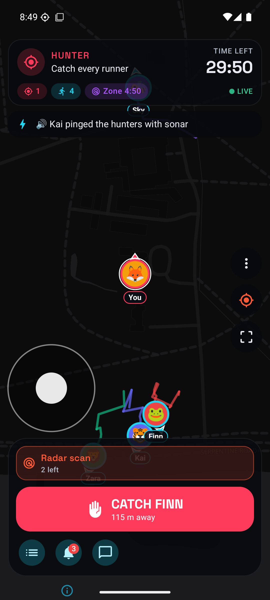
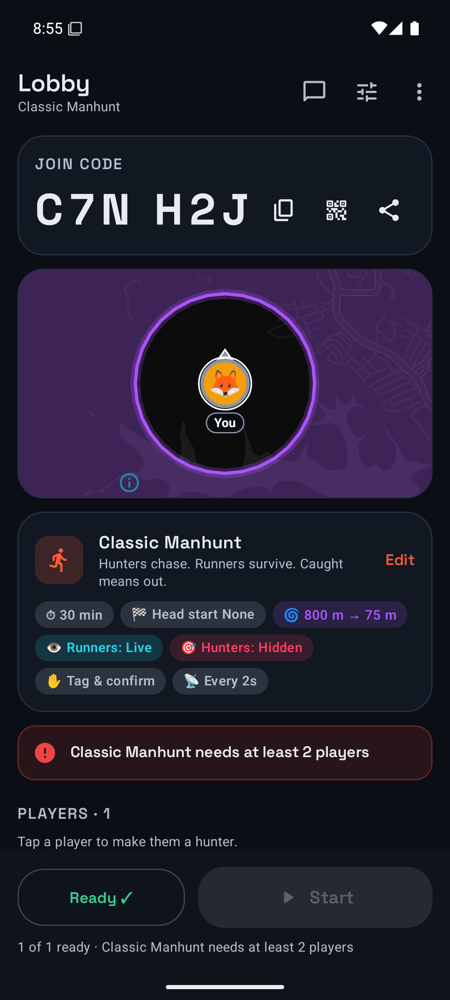
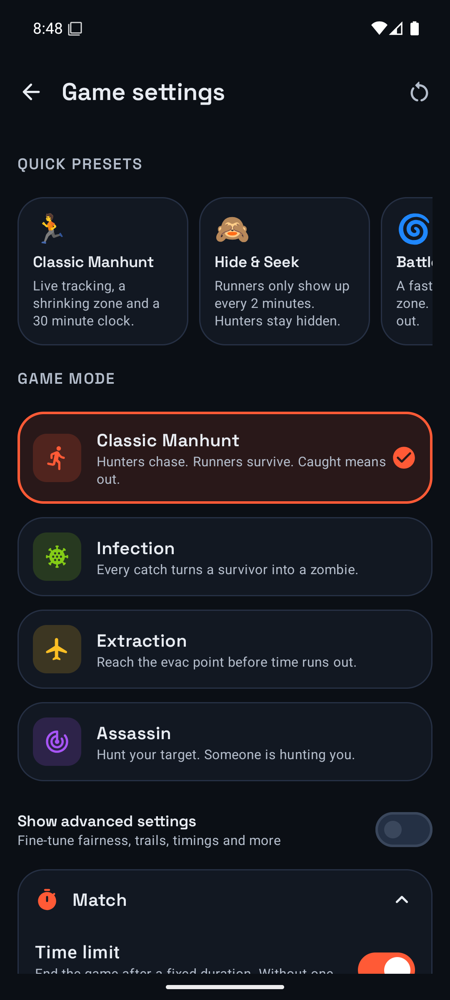
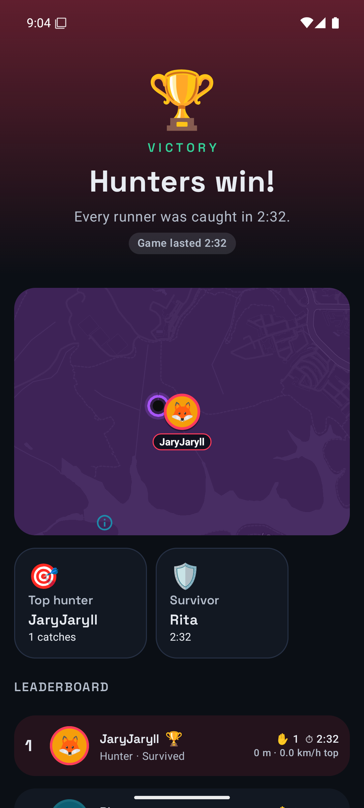
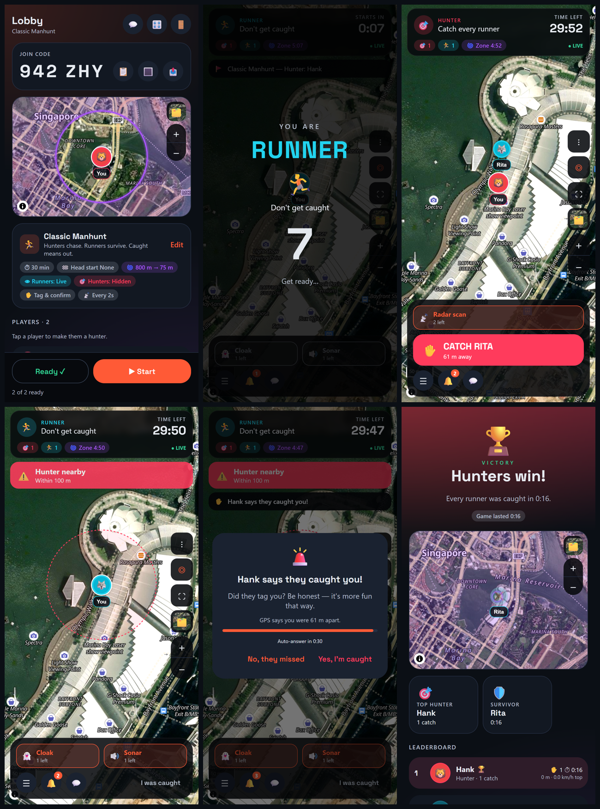

# Fugitive — real-world manhunt for Android

Fugitive turns your neighbourhood into a live game of manhunt. One person hosts, everyone joins with a
6-character code, hunters track runners on a live map, and a play zone shrinks until there's nowhere left to hide.

<p>






</p>

## Features

**Lobbies** – 6-character codes without look-alike characters (no 0/O, 1/I/L), QR codes, share links
(`fugitive://join?joinCode=…`), QR scanning, ready-up, lobby chat, lock lobby, kick, transfer host,
automatic host take-over if the host's phone dies, rejoin after an app restart.

**Choosing hunters** – host picks (tap a player), random N, volunteers, or "everyone vs one".

**Game modes** (all pluggable – see [docs/ARCHITECTURE.md](docs/ARCHITECTURE.md))
| Mode | Rules |
|---|---|
| Classic Manhunt | Hunters catch runners; caught runners are out. Survive the clock to win. |
| Infection (virus) | Caught runners become infected hunters (with a short "turning" freeze). The last survivor is revealed to everyone. |
| Extraction | Evac points open near the end; runners must hold position inside one to escape. |
| Assassin | Everyone has a secret target in a single loop; catch yours and inherit theirs. Optional self-defence. |

Nine one-tap presets: Classic, Hide & Seek, Battle Royale, The Fugitive, Fair Chase, Zombie Outbreak, The Great Escape, Assassins, Casual Walk.

**Over 60 settings**, including:
- Time limit, head start, countdown, late joiners
- Location update rate (1–60 s)
- How runners appear to hunters: live, periodic pings (any interval) or hidden; endgame reveal
- Hunters **hidden from runners by default**, optionally live or pinged
- Hunter-nearby heartbeat alert (radius, with optional direction arrow), teammates visible, spectators see all, movement trails
- Catch method: tag-and-confirm, GPS proximity, secret 4-digit code, or automatic; catch range, confirmation timeout, hunter cooldown, self-report
- Shrinking zone: centre (host / middle of players / picked on the map), start and final radius, staged (battle-royale) or continuous shrinking, number of stages, shifting circles, delay, duration, warning time. Outside the zone you are **eliminated instantly** by default, or after a grace period, or you're revealed, or just warned. Optional GPS-accuracy forgiveness; zone can apply to hunters too.
- Abilities with uses, duration and cooldown: **Radar scan** (hunters), **Cloak** and **Sonar** (runners)
- Fairness: stale-location display, disconnect timeout and penalty, minimum GPS accuracy

**The map** – 9 map types with a one-tap picker (real previews), all without an API key:
**Satellite** (aerial imagery with roads, paths and names on top), **Satellite (clean)**, **Streets 3D** (3D buildings, POIs),
**Terrain** (hill shading from elevation data), **Topographic**, Bright, Minimal, Night and Midnight. Terrain shading can be
layered onto any street or night map; 3D view tilts the camera. Paste a free MapTiler key to unlock HD satellite, Outdoor
(contours), Topo and Winter maps, or use any MapLibre style URL. Deep zoom (to building level), +/- buttons, a scale bar, a 350 MB
tile cache so the play area stays sharp on weak signal, smooth marker gliding between GPS fixes, heading arrows, accuracy halos,
ghosted "ping" markers with age badges, fading trails, follow / heading-up / overview camera, long-press team pings.

**Location** – Google fused location (falls back to the device GPS without Play services), a foreground
service so sharing continues with the screen off, a virtual joystick for practice and testing, server-clock sync,
and battery level shared alongside.

**Detail** – vibration patterns (heartbeat when a hunter is near, buzzing outside the zone), notifications
in the background, event feed, status overlays, a results screen with replay map, awards and stats, practice mode against bots, onboarding, metric/imperial, dark/light theme.

## Web version

`web/` is a browser client for your own server (Docker + nginx). It uses the same Firebase database,
security rules **and game engine** (the Kotlin rules compiled to JavaScript), so web and Android players play in
the same lobbies, and either can host. See **[web/README.md](web/README.md)**.



## Project layout

```
app/                 Application, navigation, DI wiring
core/model           Serializable domain types (Kotlin Multiplatform: JVM + JS)
core/engine          Rules: modes, settings, zone, visibility, referee, projection (KMP, unit-tested; JS build feeds web/)
core/data            Backend contract, session, referee loop, prefs, foreground service, alerts
core/location        Location sources (fused / platform / simulated)
core/map             MapLibre Compose wrapper + layer API
core/designsystem    Theme and components
core/ui              Shared domain UI (auto-generated settings form, chat, avatars, QR)
backend/local        On-device practice backend with bots
backend/firebase     Firebase Realtime Database backend
feature/*            home, lobby, game, results, settings
firebase/            Security rules + emulator config
web/                 Browser client (React + MapLibre GL + Firebase JS), Docker/nginx
docs/                Architecture, Firebase setup, Play Store guide, store assets
```

## Building

Requires JDK 17+ (Android Studio's bundled JBR works) and the Android SDK (compileSdk 37).

```bash
./gradlew :app:assembleDebug        # debug APK
./gradlew test                      # engine unit tests
./gradlew :app:bundleRelease        # signed AAB for Google Play (needs keystore.properties)
```

Without `app/google-services.json`, the app still builds and practice mode works; online play is turned off.
See **[docs/FIREBASE_SETUP.md](docs/FIREBASE_SETUP.md)** (about 10 minutes, free plan) and
**[docs/PLAY_STORE.md](docs/PLAY_STORE.md)** for publishing.

To test multiplayer locally without a Firebase account, run the Firebase emulators (see FIREBASE_SETUP.md)
and add `fugitive.firebaseEmulatorHost=10.0.2.2` to `local.properties`.
